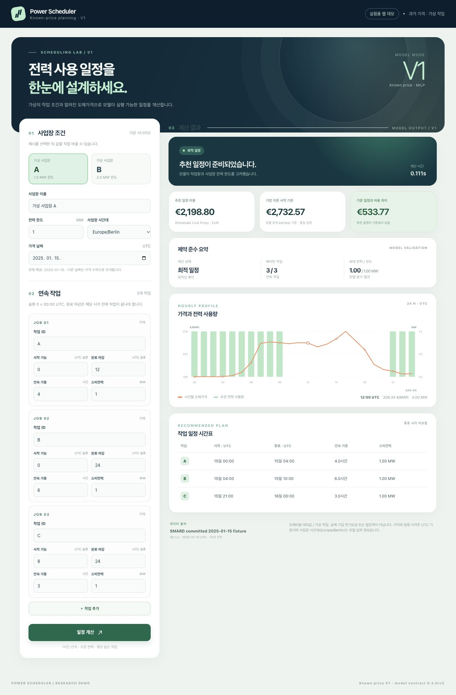
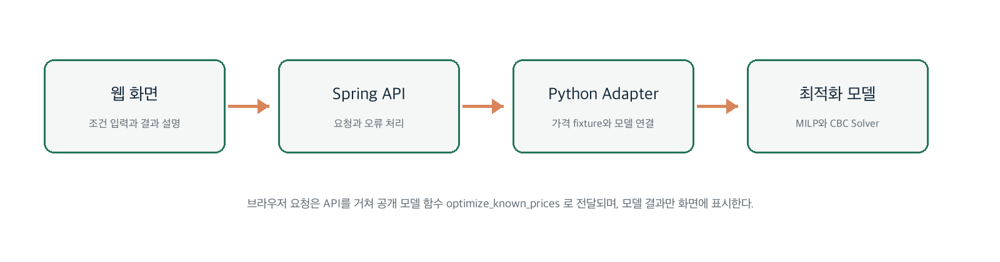
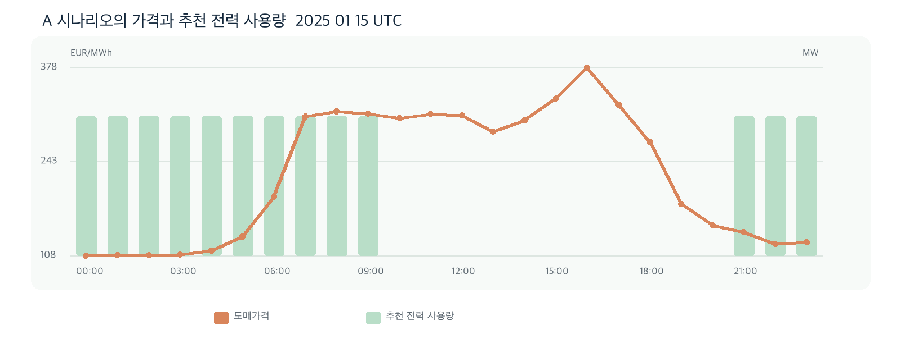

# Power Scheduler

  <strong>작업 제약을 지키면서 전력 사용 시점을 결정하는 웹 기반 일정 의사결정 MVP</strong> 
  React · TypeScript · Spring Boot · Python · MILP

> **공모전 결과물 안내** 
> Power Scheduler는 전기를 단순히 “덜 쓰게” 하는 서비스가 아니라, 마감·연속 가동·사업장 전력 한도를 지키면서 **언제 전력을 사용할지** 결정하도록 돕는 도구입니다. 사용자가 작업 조건을 입력하면, 알려진 도매가격 또는 모델의 예측가격을 사용해 실행 가능한 일정을 계산하고, V3에서는 위험 선호도까지 반영합니다.

| 현재 구현 범위 | 핵심 방식 | 검증 범위 |
| --- | --- | --- |
| V1 · V2 · V3 웹 연동 | 알려진 가격 / 가격 예측 / 위험 선호도 기반 최적화 | 과거 날짜 · 가상 작업 · 로컬 통합 검증 |

## 결과 미리보기

아래는 로컬에서 프런트엔드 → Spring API → Python 어댑터 → 최적화 모델까지 연결해 실행한 **가상 사업장 A**의 실제 화면입니다. 입력 조건과 추천 결과, 24시간 가격·사용량 그래프, 작업 시간표를 한 번에 확인할 수 있습니다.

  

| 시연 조건 | 실행 결과 |
| --- | --- |
| 가상 사업장 A · 전력 상한 1 MW · 연속 작업 3개 | <code>optimal</code> |
| 공개 가격 fixture · 2025-01-15 UTC · 1시간 간격 | 추천 일정 비용 **€2,198.80** |
| 동일 입력의 공개 <code>earliest</code> 기준 일정 | **€2,732.57** |
| 두 일정의 비용 차이 | 추천 일정이 **€533.77 낮음** |

> **중요한 해석** 
> 위 금액은 공개 도매가격과 가상 작업 조건으로 계산한 **Wholesale Cost Proxy**입니다. 실제 기업의 전기요금, 실제 절감액, 매출 성과를 뜻하지 않습니다.

## 어떤 문제를 푸는가

전력 사용량이 큰 작업은 ‘어느 시간에 실행할지’에 따라 비용이 달라질 수 있습니다. 그러나 실제 일정은 가격만 낮은 시간대로 옮길 수 없습니다. 각 작업의 시작 가능 시각·완료 마감·연속 가동시간, 그리고 같은 사업장이 동시에 쓸 수 있는 전력 한도를 함께 지켜야 하기 때문입니다.

Power Scheduler는 다음의 충돌을 한 화면에서 다룹니다.

- **운영 조건**: 작업 ID, 시작 가능 슬롯, 완료 마감, 연속 가동시간, 고정 MW를 입력합니다.
- **사업장 제약**: 모든 작업의 동시 전력 사용량이 사업장 상한을 넘지 않도록 합니다.
- **비용 판단**: 알려진 시간대별 가격을 기준으로 실행 가능한 일정 가운데 낮은 proxy 비용의 일정을 찾습니다.

## 현재 동작 방식

1. 사용자가 가상 사업장과 작업 조건을 선택하거나 직접 수정합니다.
2. 계산 모드에 따라 <code>POST /api/v1/schedules/known-price</code>, <code>/forecast</code>, <code>/risk-aware</code>로 회사 조건과 날짜·위험 설정을 전송합니다.
3. Spring Boot API와 Python 어댑터를 거쳐 공개 <code>optimize_known_prices</code>, <code>forecast_and_optimize</code>, <code>risk_aware_optimize</code> 함수를 호출합니다.
4. 화면은 계산 상태, 추천 일정, 작업별 시간표와 가격·전력 사용량을 표시합니다. V1은 earliest 비교, V2는 예측 비용, V3는 기대비용·사전 CVaR·P10/P50/P90을 표시합니다.

  

프런트엔드는 최적화 수식을 다시 구현하지 않습니다. 입력·표현·오류 안내를 담당하고, 일정 계산의 단일 기준은 별도 모델 패키지에 둡니다.

## 시연 시나리오와 확인 결과

| 시나리오 | 사업장 상한 | 상태 | 확인한 결과 |
| --- | ---: | --- | --- |
| A: 기본 제약 | 1 MW | <code>optimal</code> | €2,198.80 proxy · earliest €2,732.57 · 차이 €533.77 |
| B: 상한 확대 | 2 MW | <code>optimal</code> | €1,506.64 proxy · earliest €2,046.10 |
| 중복 작업 ID | — | <code>INVALID_INPUT</code> | 입력 오류를 별도 안내 |
| 제공되지 않은 가격 날짜 | — | <code>MISSING_PRICE_DATA</code> | 가격 누락을 별도 안내 |
| 1 MW 사업장에 2 MW 작업 | 1 MW | <code>infeasible</code> | 비용을 0으로 표시하지 않고 추천 사용량도 그리지 않음 |
| 모델 어댑터 연결 중단 | — | <code>MODEL_UNAVAILABLE</code> | 모델 연결 오류를 별도 안내 |

<code>earliest</code> 기준은 같은 회사 조건과 같은 가격을 모델의 공개 earliest 방식으로 다시 계산한 비교 기준입니다. 기준 일정이 실행 가능할 때만 차이를 표시합니다.

## 결과를 읽는 법

  

- 주황색 선은 2025-01-15 UTC의 시간별 도매가격입니다.
- 초록색 막대는 모델이 추천한 전력 사용량입니다. A 시나리오에서는 작업 A를 00:00–04:00 UTC, B를 04:00–10:00 UTC, C를 21:00–24:00 UTC에 배치했습니다.
- 그래프는 ‘가격이 낮은 시간대’만 보여 주는 것이 아니라, 각 작업의 마감·연속성·전력 상한을 모두 만족한 결과를 설명합니다.

## V1의 역할과 V2 / V3 확장

현재 V1은 미래 가격을 예측하는 AI가 아닙니다. 이미 주어진 가격과 작업 제약 안에서 실행 가능한 일정을 찾는 **의사결정·최적화 엔진**입니다. 따라서 이 저장소의 결과를 ‘실시간 AI 예측’이나 ‘실제 절감 성과’로 표현하지 않습니다.

V2에서는 학습된 가격 예측 모델의 추론값으로 일정을 계산합니다. V3에서는 확률 예측과 100개 가격 시나리오, 사용자가 선택한 α·λ로 위험을 반영한 일정을 계산합니다. 두 모드 모두 공식 과거 날짜 예제를 웹까지 연결했습니다. 예측 정확도는 과거 구간 검증으로, 비용 효과는 실제 계약요금·운영 제약을 포함한 현장 검증으로 각각 확인해야 합니다.

## 구현 범위와 한계

| 현재 구현·확인한 것 | 아직 구현·검증하지 않은 것 |
| --- | --- |
| A/B 시나리오, 작업 조건 직접 수정, 상태별 결과 화면 | 실제 기업 전기요금과 실제 절감 성과 |
| 가격·전력 사용량 그래프, 작업 시간표, earliest 비교 | 실시간 가격, 다일 가격, 15분 단위 입력 |
| 입력 오류·가격 누락·실행 불가능·연결 오류의 구분 | 인증, 저장, 권한, 배포 |
| V2/V3 추론, 위험 설정, 입력 변경 시 결과 제거 및 요청 취소 | Historical Replay 화면, 미래가격·실제 운영 검증 |

V1 가격 데이터는 모델 checkout에 포함된 **SMARD committed 2025-01-15 UTC** 하루의 24개 시간 슬롯이며, 사업장과 작업은 모두 가상입니다.

---

위 기존 스크린샷과 비용 비교는 V1 데모 결과입니다. 아래는 추가한 V2/V3 연동 및 검증 내용입니다. 공개 저장소에서는 결과·동작 범위·한계를 먼저 확인할 수 있도록 구성했습니다.

## V2 / V3 사용법과 API 계약

왼쪽 **계산 모드**에서 V2 또는 V3를 선택하고 공급일 **2025-10-07**, 가상 사업장 A로 일정 계산을 실행한다. V3 기본값은 **α=0.9 / λ=0.5**이며 직접 변경할 수 있다. λ=0은 기대비용 기준이다. 선택한 위험 설정이 최선이라는 주장은 하지 않는다.

| 모드 | 요청 필드 (company 공통) | 결과 의미 |
| --- | --- | --- |
| V1 / known-price | `price_date` | 알려진 가격의 Wholesale Cost Proxy + earliest 비교 |
| V2 / forecast | `target_date` | 점 예측가격의 비용 추정 + 예측가격 그래프 |
| V3 / risk-aware | `target_date`, `alpha`, `risk_lambda` | 시나리오 기대비용, 사전 CVaR, 평균가격·P10–P90 범위·P50 |

HTTP API 버전 `/api/v1`은 모델 모드 V1/V2/V3와 독립적이다. V2/V3 응답의 `prices`와 `baseline`은 null이며, 가격 그래프는 `decision.forecast_prices`, `quantiles`, `target_timestamps`를 사용한다. 알려진 가격으로 다시 평가하거나 브라우저에서 비용·최적화를 재계산하지 않는다. Oracle Regret은 planning 화면에 표시하지 않는다.

공급일은 회사 표시 시간대와 무관하게 **Europe/Berlin** 기준이다. 2025-10-07의 슬롯 0은 **2025-10-06 22:00 UTC**, 종료는 exclusive다. UI의 일정과 차트는 UTC로 표시하고 시작 timestamp를 함께 노출한다. DST 23/25시간 공급일과 학습·보정 이전 날짜는 모델이 거절한다. V1은 기존 2025-01-15 fixture만 제공한다.

모드·날짜·위험 설정·작업을 바꾸면 이전 결과를 숨기고 진행 요청을 취소한다. 예측 모델 누락/불일치, 추론 실패, 통신 실패, 입력 오류와 실행 불가능 결과를 구별한다. 실패 시 비용을 0으로 바꾸거나 대체 모델을 사용하지 않는다. V3 그래프의 분위수는 가격 분포이며 비용 CVaR와 다른 지표다.

## 로컬 실행과 검증 기준

검증 모델 SHA: **08d9db5b40e0caa0e869659986c544959046ebc9**, package **0.3.0rc2**. Application 버전은 package.json의 0.1.0으로 별도 관리한다. 공식 [Quickstart](../power-scheduler-model/docs/DEVELOPER_QUICKSTART.md), [Handoff](../power-scheduler-model/docs/SERVICE_HANDOFF.md), [Contract](../power-scheduler-model/docs/SERVICE_CONTRACT.md), [Schema](../power-scheduler-model/docs/INPUT_OUTPUT_SCHEMA.md), [examples/service](../power-scheduler-model/examples/service/)를 기준으로 연결했다.

인접 backend/model checkout과 Python 환경이 필요하다. 최초 설치 및 macOS OpenMP 설정은 [backend README](../power-scheduler-backend/README.md)를 따른다. 각각 별도 터미널에서 실행한다.

~~~sh
# backend: 모델 어댑터 (V2/V3 artifact를 시작 시 로드)
.venv/bin/python python_adapter/app.py

# backend: Spring
./gradlew test bootJar
java -jar build/libs/power-scheduler-backend-0.1.0.jar

# frontend
npm ci
npm run dev -- --port 5174 --strictPort
~~~

브라우저: [http://127.0.0.1:5174/](http://127.0.0.1:5174/). `SPRING_API_URL`로 Vite 프록시 대상(기본 http://127.0.0.1:8080)을 바꿀 수 있다.

2026-10-30 검증:

- `npm run build` (TypeScript 검사 포함) 통과.
- backend Python 9개 / Spring 4개 테스트 통과, Vite 프록시를 통한 실제 HTTP smoke 14건 통과.
- 기본 공식 예시: V2 예측비용 **€1,215.61**, V3 기대비용 **€1,461.43**, 사전 CVaR90 **€2,624.05**. 날짜와 비용 기준이 다른 V1/V2/V3 수치를 절감액이나 모델 순위로 비교하지 않는다.
- 브라우저 V2/V3 정상 결과, V3 중복 작업 ID 오류·infeasible의 null 비용, 모드 변경 시 오래된 결과 제거 확인.
- 기존 V1 정상·명시 가격·중복 ID·가격 누락·infeasible API 회귀 검증 통과.

모델 계산 로직과 모델 저장소는 수정하지 않았다. 과거 데이터의 연구 추론과 가상 작업 시연이며, 실시간 가격 서비스·실제 기업 절감 성과·운영 배포·동시성은 미검증이다.
